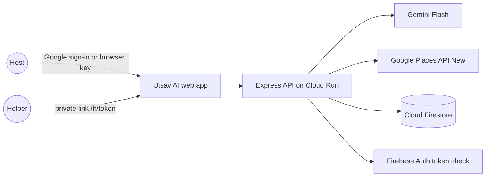

# Utsav AI

**Plan it together. Celebrate it together.**
A GenAI celebration planner for Indian families, built for PromptWars Virtual, Challenge 05: Celebration & Event Planner.

Utsav AI turns a wedding, birthday or community event into a full plan in seconds (a rupee budget with 10% kept aside, a timeline, guided steps, vendor picks and ideas). Then it splits the work across the family. Every helper gets a private WhatsApp link with a beginner's guide, a call script in Tamil or English, red flags to avoid and real vendors near them. The host watches the whole celebration fill up on one orbit.

> Built for families, not agencies.

**Live app:** https://utsav-ai-510810666377.asia-south1.run.app · **Demo video:** https://youtu.be/hEyg1QWsZZM

---

## The problem

Indian celebrations involve big budgets, many vendors, many rituals and many relatives who help out. Planning lives in WhatsApp groups and notebooks. The relatives who help often have never booked a caterer or a hall, so tasks slip, quotes get overpaid and nobody knows what is done.

## What it does

| | Feature | How |
|---|---|---|
| 1 | **AI plan in seconds** | 5-step wizard → Gemini writes category steps, budget shares and ideas → the server checks the maths (caps + 10% buffer = total, every date before the event) |
| 2 | **Family orbit** | The event is the planet; every category orbits it with its helper, due date, progress ring and next step. Overall "% event ready" in the centre |
| 3 | **Guided steps** | Each category has a step ladder. Tick a step or press *Mark as Complete* and the orbit updates |
| 4 | **Real vendors** | Google Places (New) finds real businesses near the event city; Gemini only ranks and explains them and can never invent one. Call, WhatsApp, Maps, Shortlist |
| 5 | **Helpers without sign-up** | Host adds a relative, picks a category and language, and shares a private link on WhatsApp |
| 6 | **Helper app (4 pages)** | Phone-first app with a bottom tab bar: **Today** ("Sana, the food is in your hands", one *Do this now* card, things to watch, family progress), **Steps** (checklist, best quote, notes for the host), **Vendors** (top match + more options, filter by best / lowest price / shortlisted, Call · WhatsApp · Maps · Save), **Ask** (task-only AI chat with voice input). Call script with *Read aloud* in English and Tamil |
| 7 | **Privacy by role** | Helpers see the team's progress but can change only their own task; the full budget is hidden from them unless the host turns it on. Enforced on the server |
| 8 | **Live updates** | When a helper ticks a step, the host's ring fills and a toast appears |
| 9 | **Ask Utsav co-pilot** | "Cut budget by 15%", "Move the event to 28 November", "Add a mehendi function" → before/after diff → *Apply changes* or *Discard* |
| 10 | **Budget, Timeline, Family views** | Donut + editable caps + saved quotes; steps grouped Overdue / This week / Next week / Later / Done; helper cards with WhatsApp share, copy link, their view and remove link |
| 11 | **Share** | WhatsApp-ready summary, copy, and save as PDF |
| 12 | **Every family's own flow** | Pick a tradition (Tamil, Telugu, Kerala, North Indian, Bengali, Christian, Muslim, or your own mix; kids, first, milestone or 60th birthdays; Pongal, temple festival, Ganesh Chaturthi, Christmas, Eid, college fest). Its functions load in order with dates (e.g. Haldi 2 days before, Walima 1 day after). Remove any, add from other traditions, or type your own. Each function adds tasks to the right helper, due the day before, and shows on the timeline and the helper's Today page |
| 13 | **India first** | ₹ with Indian grouping (12,00,000), rituals and food per event type, Tamil for helpers |

## How a family uses it

**Host**
1. Open the site → *Try a sample plan* (no sign-up) or *Start my plan* / *Continue with Google*.
2. Wizard: event type and tradition → city & date → guests & budget → functions (add, remove, your own), food, feel → *Create my plan*. A lamp lights up while Gemini writes it.
3. The orbit appears. Tap a category to open its panel: guided steps, vendor shortlist, next action.
4. *Assign a helper* → name, relation, language → *Share on WhatsApp*.
5. Watch the orbit fill up. Use *Ask Utsav* to change the plan. Share the summary with the family.

**Helper (on a phone)**
1. Tap the WhatsApp link. No login.
2. **Today** tab: your category, budget cap and days left. Switch to தமிழ் if you like.
3. Follow *Do this now* → **Vendors** tab → call the vendors with the script → save the best quote on **Steps**.
4. Stuck? **Ask** tab. Mark the step done. The host sees it instantly.

## Architecture



- **One container on Google Cloud Run** serves the app and `/api/*`.
- **All writes go through the API.** Firestore is never written from the browser, so permissions live in one place (`lib/plan.js → applyOp`).
- **All keys stay on the server.** Place photos are proxied through `/api/photo`, so the Places key never reaches the browser.
- **Gemini never invents vendors.** It ranks only the place IDs the server sent it; unknown IDs are dropped.
- **Graceful fallback.** Without keys the app still runs: built-in plan templates, rule-based co-pilot, labelled example vendors.

### Security model

| Who | How they are identified | Can |
|---|---|---|
| Host | Firebase ID token (Google) and/or a random per-browser key (stored hashed) | Everything on their own plans |
| Helper | Random 32-character link token, stored only as a SHA-256 hash | Read the team board; update steps, notes, quotes and shortlist on **their own** category only (403 otherwise) |
| Anyone else | — | Nothing. Revoked links return "This link is no longer active" |

Rate limits on AI and vendor routes (20/min per IP), input validation on every route, user text always HTML-escaped before rendering, JSON-only errors without stack traces, and security headers (`nosniff`, `X-Frame-Options: DENY`, `Permissions-Policy`, HSTS on HTTPS, `no-store` on the API). Helper link tokens are 32 random characters and only their SHA-256 hash is stored.

## Tech

Node.js 22 · Express · `@google/genai` (Gemini Flash family, JSON output; `GEMINI_MODEL` picks the model and the app falls back to other Flash models when one is busy or out of quota) · Google Places API (New) · Firebase Auth + Firebase Admin · Cloud Firestore · Google Cloud Run. Frontend is dependency-free HTML, CSS and JavaScript (Cormorant Garamond, Jost, Mrs Saint Delafield, Noto Sans Tamil).

```
server.js        Express app, routes, auth, rate limit
lib/plan.js      plan building, budget maths, permissions, helper redaction, co-pilot rules
lib/ai.js        Gemini + Places with fallbacks
lib/store.js     Firestore (Cloud Run) or memory (local)
public/app.js        views, router, event handlers
public/js/util.js    escaping, ₹ and date formatting, progress maths (pure, unit-tested)
public/js/i18n.js    English and Tamil text for helpers, red flags, step hints
public/traditions.js regional traditions and their functions, shared by server and browser
test/                node:test unit and API tests
scripts/a11y-check.mjs  axe-core accessibility audit of every screen
```

## Run locally

```bash
npm install
cp .env.example .env      # add your keys (optional: it runs without them)
npm start                 # http://localhost:8080
npm test
```

## Deploy to Google Cloud Run (from Cloud Shell, no installs needed)

1. Push this repo to GitHub (public).
2. Open https://console.cloud.google.com → project `utsav-ai-513215` → click the **Cloud Shell** icon (top right).
3. In Cloud Shell:

```bash
git clone https://github.com/<you>/utsav-ai.git && cd utsav-ai
gcloud config set project utsav-ai-513215
gcloud run deploy utsav-ai --source . --region asia-south1 --allow-unauthenticated \
  --set-env-vars "GOOGLE_CLOUD_PROJECT=utsav-ai-513215,FIREBASE_AUTH_DOMAIN=utsav-ai-513215.firebaseapp.com" \
  --set-env-vars "GEMINI_API_KEY=YOUR_KEY,PLACES_API_KEY=YOUR_KEY,FIREBASE_API_KEY=YOUR_WEB_API_KEY,FIREBASE_APP_ID=YOUR_APP_ID"
```

4. Copy the `https://utsav-ai-....run.app` URL it prints.
5. Firebase console → Authentication → Settings → **Authorized domains** → add that domain (without `https://`).

Firestore (Mumbai, production mode) must exist. Client access is denied by `firestore.rules`; the server uses its service account.

## Accessibility

Checked with axe-core against WCAG 2.1 A/AA on 20 screens (desktop and phone): **0 issues** (`npm run a11y`).

- Skip link, one `<main>` landmark and one `<h1>` per page; page title changes with every view.
- Dialogs use `role="dialog"` and `aria-modal`, move focus inside, keep Tab inside, close on Escape and return focus to the button that opened them.
- Focus stays on the same control after the screen re-renders (ticking a step, switching tabs).
- Every icon button has a text name; decorative SVGs are `aria-hidden`; status is shown in words, not only colour.
- The helper app sets `lang="ta"` when Tamil is chosen, so screen readers switch voice.
- Visible focus rings, large touch targets on the phone app, and `prefers-reduced-motion` turns animations off.

## Tests

```
npm run check          # ESLint + 25 tests
npm run test:coverage  # line coverage report
```

- **Plan logic** (`test/plan.test.js`): caps + 10% buffer always equal the total, due dates, validation, tradition functions and their dated tasks, helper permissions and redaction, co-pilot changes, token length.
- **API** (`test/api.test.js`): the real Express app on a random port: security headers, 401/403/404/422 paths, full host → helper flow, a helper blocked from another task and from host-only actions, revoked links, co-pilot preview vs apply, labelled example vendors.
- **Browser modules** (`test/client.test.js`): HTML escaping, ₹ formatting, progress maths, English/Tamil text parity, every tradition well formed.
- **AI fallback** (`test/ai.test.js`): skips a model whose quota is used up and retries a busy one.
